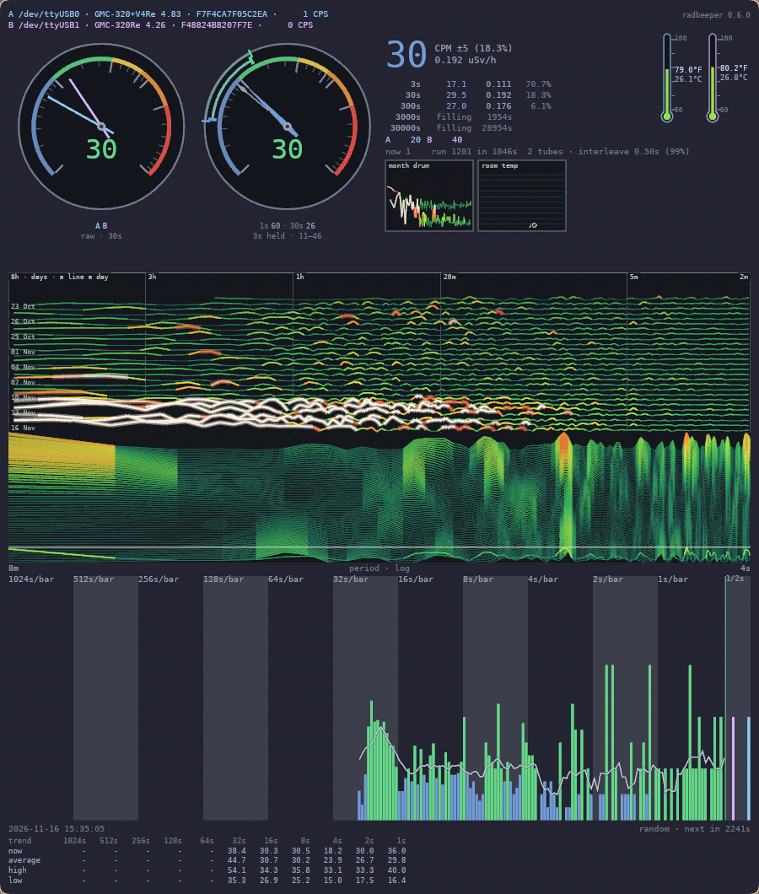

# RadBeeper

**Reads a GQ GMC-320 Geiger counter over USB: shows what it is counting,
keeps a record with no gaps, and gives its temperature to anything that
asks.**

MIT · `0.6.0` · Linux and macOS · [vonglurt.github.io/radbeeper](https://vonglurt.github.io/radbeeper/)



---

## What it does

| | |
|---|---|
| **Talks to the counter** | A GQ GMC-320 Plus on its own USB cable. RadBeeper finds it, reads a count every second, and reads back what the counter recorded while nothing was listening. Two counters are read at once. |
| **Shows it** | In a terminal (`radbeeper watch`) or a window (`radbeeper-gui`): the reading, five averages, the counts, and a drum spectrogram that shows whether anything is arriving on a schedule, by the minute, the day and the month. |
| **Logs it** | A service writes a row every thirty seconds to a plain text file, whether or not anything is open, and fills its own gaps from the counter's memory. One command turns the log into a web page. |
| **Reads the temperature** | A GMC-320 has a thermometer. It is read between two counts and logged beside them, in degrees Celsius to the tenth. |
| **Answers other programs** | `radbeeper now --json` gives counts a minute, dose rate and temperature for each counter from the running service, without touching the port. |
| **Serves a Copal fleet as a room thermometer** | On a [Copal](https://github.com/vonglurt/copal) machine the service runs from boot, and the fleet's collector reads the counter's temperature from its log. See below. |

[A tour, in pictures](docs/tour.md) shows each part. [The live
report](https://vonglurt.github.io/radbeeper/monitor.html) and [the days and
months](https://vonglurt.github.io/radbeeper/drums.html) are what it
publishes.

---

## What you need

| | |
|---|---|
| **The counter** | A **GQ GMC-320 Plus**, switched on. A GMC-300, 500 or 600 is found and read too; the temperature needs a GMC-320 with firmware 3.01 or later. |
| **Its own USB cable** | The one that came with it. A charge-only cable carries no data. |
| **A computer** | Alpine Linux, or Copal, which is built on it. Or a Mac, from a copy of this repository. |
| **Permission to use the port** | On Linux, once: `doas adduser $USER dialout`, then log out and back in. |

If `radbeeper probe` finds nothing it says which of four things is wrong;
[Troubleshooting](docs/troubleshooting.md) has the fix for each.

---

## Install

**Which one.** The temperature, the day and month drums and the Mac build
were added on 16 November 2026 and are in this repository, not yet in a
release. The release on crates.io and the releases page is 0.6.0, from before
them. For the new parts, build from source.

**From source, on Linux or a Mac** (needs Rust):

```sh
git clone https://github.com/vonglurt/radbeeper && cd radbeeper
make install         # the program, on PATH; on Linux, a menu entry for the monitor
make gui-install     # the window too
```

`make gui-install` puts the window where the desktop looks for it:

| | |
|---|---|
| **Copal, and any Linux desktop** | `radbeeper-gui` beside `radbeeper`, and a **RadBeeper** entry in the launcher. |
| **macOS** | **RadBeeper.app** in `/Applications`. Double click it: it starts the logging if nothing is running, leaves it running when the window is closed, and opens the window. |

**The released version, on Linux:**

```sh
cargo install radbeeper            # or a ready-made binary from the releases page
```

**On Copal** the program is built from `~/code/radbeeper` and the service is
set up to start at boot; `copal-build radbeeper` rebuilds it.

---

## First run

With the counter plugged in and switched on:

```sh
radbeeper probe      # find it, and check it is talking
radbeeper service    # read and log every counter, and serve the others; leave it running
radbeeper watch      # the monitor, in a terminal -- q to quit
radbeeper-gui        # or the same counter in a window
```

**The window needs the service running**: it draws what the service reads and
never opens the port itself. On Copal the service starts at boot; on a Mac,
RadBeeper.app starts it for you; anywhere else, start it first. The monitor
reads the counter directly when no service is running.

The monitor and the window can be opened and closed as often as you like. The
logging carries on underneath and does not miss a second.

---

## The log

One directory holds everything: `/var/lib/radbeeper` on Linux when it can be
written to, `~/.local/share/radbeeper` otherwise and on a Mac.

| File | What is in it |
|---|---|
| `cpm-<serial>-YYYY-MM.tsv` | the counts: a row every thirty seconds, for each counter and month |
| `temp-<serial>-YYYY-MM.tsv` | the counter's temperature, a row every thirty seconds |
| `spectrum-YYYY-MM.tsv` | a line of the drum spectrogram for every 512 seconds |
| `drum-day.tsv`, `drum-month.tsv` | a line of spectrum for each whole day and month |
| `random-<serial>-…` | the random numbers drawn from decay timing, and the counts behind each |

They are plain text and open in any spreadsheet. [The log](docs/the-log.md)
has every column.

---

## A temperature sensor for a Copal fleet

A counter plugged into one machine of a fleet is a thermometer in that room.

- **Ask the service:** `radbeeper now` prints a line for each counter, and
  `radbeeper now --json` one object: counts a minute, dose rate, temperature,
  and how old each is. It reads the running service and never the port.
- **Or read the file:** the newest line of `temp-<serial>-YYYY-MM.tsv`.
- **Orrery does the second.** The fleet's five-second collector in
  [Orrery](https://github.com/treadcore/orreryq) (`tools/fleet-telemetry.sh`)
  reports the newest reading as `room.rad<last four of the serial>.c`, beside
  the counts a minute it already took, where a machine's radbeeper writes
  that file.

The reading is the inside of the counter's case, not the air of the room, and
there is no humidity. [The thermometer](docs/the-thermometer.md) is the
report on how it is read without losing a count.

---

## Commands

| | |
|---|---|
| `probe` | every counter on the machine, held by the service or free, and what its last start did |
| `watch` | the monitor, logging while it is open; `--no-log` to only watch |
| `clock` | how far the counter's clock is out; `--set` corrects it, as every start of `service` and `watch` does |
| `cpm` | one 30-second average, for a script |
| `now` | what the running service reads this minute, for another program: counts a minute, dose rate and temperature for each counter; `--json` for one object |
| `service` | log every counter found |
| `hotplug` | open the monitor when a counter is plugged in |
| `backfill` | fill the log's gaps from the counter's memory |
| `random` | a 256-bit key from decay timing |
| `site` | where a counter is, and where it has been |
| `export` | build the web page from the logs |
| `frames list` / `show` | the raw seconds behind each key |
| `log info` / `log pull` | how much the counter's memory holds, and download it |

`radbeeper --help` lists every command and option.

---

## Learn more

| | |
|---|---|
| [A tour, in pictures](docs/tour.md) | the monitor, the window, the drums, the temperature, two counters, the web page and the random numbers |
| [Feature guide](docs/FEATURE_GUIDE.md) | what each part is, why it exists, and how it fits the rest |
| [Reading the window](docs/reading-the-window.md) | every number on the window |
| [Reading the drum spectrogram](docs/reading-the-drum-spectrogram.md) | the striped chart, its day and month papers, and how to tell chance from something real |
| [Troubleshooting](docs/troubleshooting.md) | what to do when the counter is not found |
| [Running it](docs/running-it.md) | starting at boot, and publishing |
| [Technical description](docs/technical-description.md) | how it works, and [all the lab reports](docs/technical-description.md#the-lab-reports) |
| [The architecture](docs/architecture.md) | how it is built, with the code: the processes, the path of a count, the files, and a review of the design |
| [A user experience review](docs/user-experience-review.md) | what it is like to install and use, and what to fix first |
| [The thermometer](docs/the-thermometer.md) | reading the temperature in the middle of the count stream |
| [Security](SECURITY.md) | what is in scope, and how the supply chain is kept small |
