<!-- SPDX-License-Identifier: MIT — Copyright (c) 2026 Paul Richeson -->

# RadBeeper — feature guide

A tour in pictures, in the order a person meets the program: find the counter,
watch it, keep the record, fill its gaps, draw random numbers out of it, and
publish it. Each part says what the feature is, **why it exists** and **how it
fits** the rest.

> **Where the pictures come from.** The terminal pictures were taken on
> 2026-10-20 by `python3 tools/featureguide.py`, running the real `radbeeper`
> 0.6.0 binary against **simulated counters**: `tests/fake_gmc.py`, a GMC-320
> on a pseudo-terminal with a seeded Poisson background. The serial code, the
> averaging, the log and the keys are the program's own; only the counts are
> not from a tube. That is why their serials are made up (`0A1B2C3D4E5F60`,
> `1B2C3D4E5F6071`, `2C3D4E5F607182`) and their ports are `/dev/pts/N`
> instead of `/dev/ttyUSB0`. The two web pages were built by
> `radbeeper export` from this repository's own `logs/`, which are a real
> counter's published record. **The window (`radbeeper-gui`) was not run for
> this guide**: its pictures are copied from `docs/screenshots/`, recorded by
> `make gui-drum` on a real desk with two real counters, and one was cropped
> to leave out the desktop's bar.

## Contents

1. [Find the counter: `probe`](#part-1)
2. [Watch it: the monitor in a terminal](#part-2)
3. [The window: `radbeeper-gui`](#part-3)
4. [Is it radiation? The drum spectrogram](#part-4)
5. [Keep a record: the log](#part-5)
6. [No gaps: the counter's own memory](#part-6)
7. [Random numbers out of decay](#part-7)
8. [The raw seconds behind every key: frames](#part-8)
9. [Publish it: one page, no scripts](#part-9)
10. [How it fits together](#part-10)

The setup is three lines, from the [README](../README.md):

```sh
cargo install radbeeper            # or a ready-made binary from the releases page
doas adduser $USER dialout         # once, then log out and back in
radbeeper probe                    # it should name your counter
```

<a id="part-1"></a>
## 1. Find the counter: `probe`

**Why it exists.** The commonest problem with a USB counter is that the
computer cannot see it at all, and the four causes look alike: the counter is
off, the cable carries only charge, nothing is plugged in, or the kernel has no
USB-serial driver. `probe` is the first command so that the first thing a new
user learns is either "it works" or which of those it is.

**How it fits.** Everything else reads the same port `probe` found. If a
service is already holding the port, `probe` asks it rather than the port, so
it is safe to run at any time.

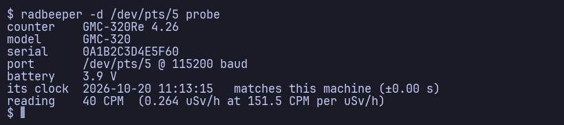

*`radbeeper probe`, pointed at a simulated counter with `-d`.*

1. What the counter says it is: model, firmware and serial number.
2. The port and the baud rate that answered (115200 is tried, then 57600).
3. Battery voltage, and the counter's clock against this machine's.
4. Its own reading, in CPM and in µSv/h by the tube factor (151.5 CPM per
   µSv/h for the M4011 in a GMC-320; `--cpm-per-usvh` sets another).

**Check yourself**

- No `ttyUSB` at all? [Troubleshooting](troubleshooting.md) goes through the
  four causes in the order they are worth checking.
- `Permission denied` is the `dialout` group: add yourself, then log in again.

<a id="part-2"></a>
## 2. Watch it: the monitor in a terminal

**Why it exists.** A counter's own display shows one rolling 60-second count:
one number, one time constant. A person holding a rock to the tube wants three
seconds; a person asking what the room's background is wants an hour. The
monitor shows the same measurement over five windows at once, each ten times
longer than the last, with how precisely each one knows its number.

**How it fits.** **The monitor is also the logger.** Only one program can hold
the port, so `watch` does what the service does with a screen on top: it reads
the counter's history on connect, writes a row every thirty seconds, appends
every random line, and writes `index.html` beside the log. With the boot
service already running, `watch` attaches to the service's socket instead and
the port is never touched. `--no-log` only watches.

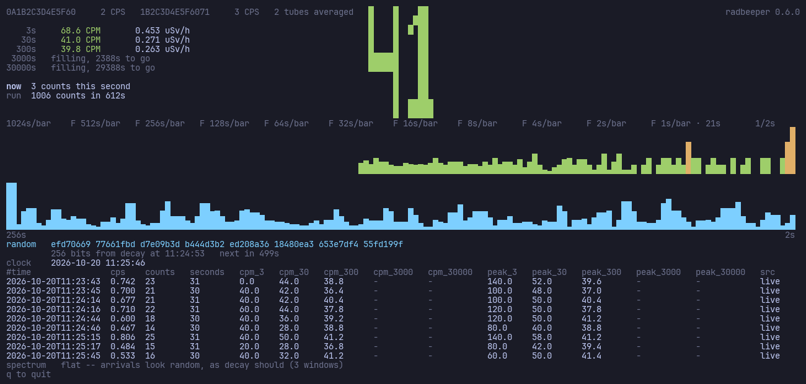

*`radbeeper -d /dev/pts/N -d /dev/pts/M --logs logs watch`, ten minutes in.*

1. The counters, each with what it counted in the last second, and how they
   are combined (`2 tubes averaged`); the version in the corner.
2. The five averages. 3 s, 30 s and 300 s have numbers (68.6, 41.0 and
   39.8 CPM, against 40 CPM per fake); 3000 s and 30000 s say how long they
   still need.
3. The big number: the 30-second CPM, `41`, in block digits that can be read
   from across a room.
4. `now` and `run`: this second's count, and 1006 counts in 612 s so far.
5. **The counts, compressing as they age**: a second a bar on the right, and
   each panel to its left twice as long a bar, out to 1024 s. Half a day in one
   row of a terminal.
6. **The spectrum** (the blue band, periods from 256 s on the left to 2 s on
   the right), looking for anything arriving on a schedule. Its verdict is the
   second-last line: `flat -- arrivals look random, as decay should`.
7. **The random line**: 256 bits earned at 11:24:53, and the countdown to the
   next.
8. **The log, scrolling**: the rows as they go to disk, so what is on the
   screen is what is in the file.

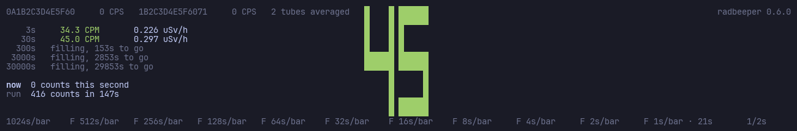

*The same session at 147 s: the long windows say how long they
have to go rather than show a number they have not earned.*

**Check yourself**

- A window that says `filling` is not broken; it is a window that is not full
  yet, and the log leaves its column empty for the same reason.
- The precision is `100% / √N` for the N counts a window holds: decay is
  Poisson, and the counts are the whole of the uncertainty.
- `q` quits. The logging under it carries on if the service is running.

<a id="part-3"></a>
## 3. The window: `radbeeper-gui`

**Why it exists.** A terminal is the right place to start and the wrong place
to leave a monitor running all day on a desk. The window is an instrument
cluster: a round dial per counter on a fixed logarithmic scale, with the bands
painted on the face, so the reading can be taken from across a room.

**How it fits.** **It opens no serial port; it has no code for one.** It reads
the same stream the service or the monitor serves, so what it shows is what the
log has, and it can be opened and closed all day while the logging carries on
underneath. It is a second crate, installed with `make gui-install` from a copy
of the repository, so that `cargo install radbeeper` stays a one-dependency
build.

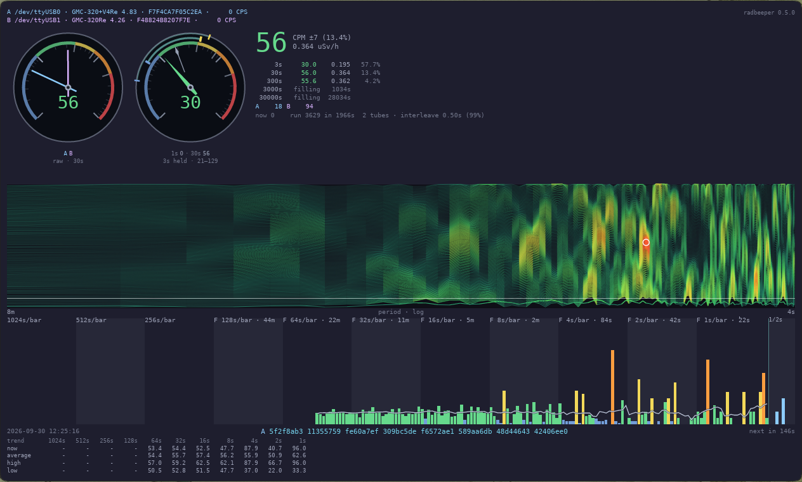

*From the repository's `docs/screenshots/gui-dark.png` (radbeeper 0.5.0, two
real counters, about half an hour in), cropped to the window.*

1. **The counters**: which are connected, by port, model, firmware and serial,
   and what each counted in the last second.
2. **The dials**: the reading as a needle. The bands are *attenuated* (under
   3 CPM), *nominal* (from 30), *advisory* (120), *warning* (240) and
   *deadly* (600).
3. **The big number**: CPM over the last 30 seconds, its standard deviation,
   and the dose rate.
4. **The averages**: 3 s, 30 s, 300 s, 3000 s and 30000 s, each with its
   precision; then each counter's own figure, `A 18 B 94`, and the status line
   (`2 tubes · interleave 0.50s (99%)`).
5. **The drum spectrogram** (part 4), and under it **the counts**: a bar a
   second on the right, older counts packed coarser to the left, the trend
   line over them.
6. **The key**: the newest random number and the counter that earned it, and
   the countdown to the next.
7. **The table**: the trend line in numbers, for each panel of the counts.

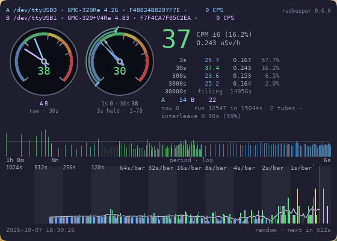

*From `docs/screenshots/gui-small.png` (radbeeper 0.6.0). In a small window
the table goes first and the charts last.*

**Check yourself**

- The window follows the desktop's light or dark theme, read once when it
  opens; `--theme antiquity` starts it light.
- **Two counters do not double the reading.** The big number is the *mean* of
  the counters; the second tube makes it more precise.
- An empty space beside a counter means it has stopped answering; it is left
  out of the reading until it comes back.

<a id="part-4"></a>
## 4. Is it radiation? The drum spectrogram

**Why it exists.** Decay has no rhythm. Anything reaching the counter on a
schedule is something else: a fan, electrical noise, a fault, the counter
batching its reports. In the big number all of those look like more
radiation. On this chart they look like a stripe.

**How it fits.** It is drawn from the same counts as everything else, on the
same period axis as the spectrum at its foot. The same health check, "flat is
the good answer", is applied to every random key (part 7) and to every frame
(part 8).

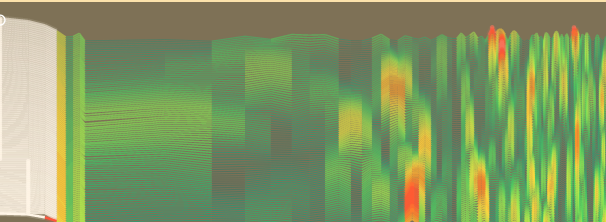

*From `docs/screenshots/gui-drum-spectrogram.png`, the light theme.*

1. **A paper chart, like a seismograph's.** A new line every eight seconds at
   the bottom; the older ones move up. Each line is made from the last eight
   and a half minutes of counts.
2. **Left to right is how often**: slow rhythms on the left, fast on the right,
   from about once an hour to once every few seconds.
3. **The pen gets hotter and wider as the signal gets stronger**: green is
   ordinary background, yellow is as much as chance manages, red and white are
   more.

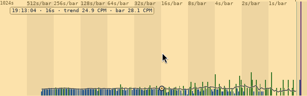

*From `docs/screenshots/gui-drum-hover.png`. Point at a bar of the counts and a
circle marks the trend there, with the time, how long the bar covers, and the
trend's and the bar's rate in CPM.*

**Check yourself**

- **Mostly green**: all is well. **A warm patch that comes and goes**: chance.
- **A hot stripe from top to bottom that stays put**: something real is
  arriving at that interval. One spike is noise, and so is a streak under
  thirty-two rows long.
- [Reading the drum spectrogram](reading-the-drum-spectrogram.md) is the full
  guide; [the drum spectrogram](the-drum-spectrogram.md) is the lab report.

<a id="part-5"></a>
## 5. Keep a record: the log

**Why it exists.** A reading on a screen is gone when the screen closes. The
log is a row every thirty seconds, in a plain text file for each counter and
each month, that opens in any spreadsheet and sorts chronologically with a bare
`sort`.

**How it fits.** The boot service (`radbeeper service`) and the monitor write
the same rows through the same code, so it does not matter which is running.
Every published page is built from these files and nothing else. **Nothing is
ever merged into a counter's own file**: with two counters the room's record is
written beside them as `cpm-merged-YYYY-MM.tsv`.

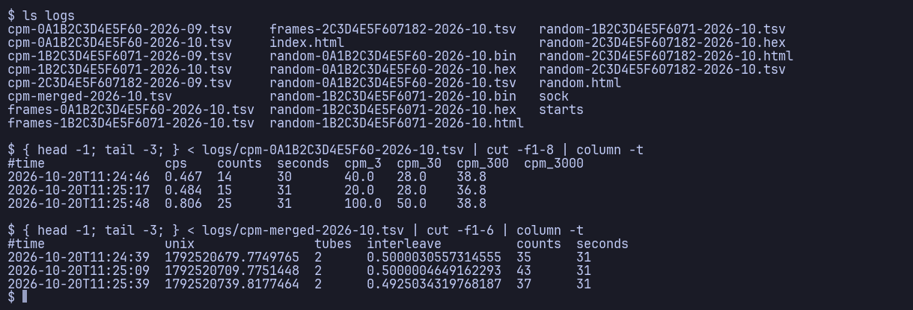

*The log directory after the ten-minute session in part 2.*

1. `ls logs`: one `cpm-<serial>-YYYY-MM.tsv` per counter per month (the
   September files hold what the backfill recovered from the fakes' flash),
   `cpm-merged-…` for the room, the keys (`random-*.tsv`, `.hex`), the frames
   (`random-*.bin`), the pages the monitor wrote, the socket (`sock`) and the
   `starts` record.
2. A counter's own rows: `time` first, so a plain sort is chronological; `cps`
   per one second; `counts` and `seconds` so the division can be checked; then
   one column per window. `cpm_3000` is empty: that window is not full yet.
3. The merged rows: how many tubes, and how far apart their answers fell
   (`interleave` 0.50 s is two tubes sampling the room twice a second).

**Check yourself**

- **An empty field is not a zero.** It is a window that was not full yet.
- The `peak_*` columns are the highest each window reached *since the last
  row*, so a source that came and went between two rows is still recorded.
- `src` is `live` if this machine measured the row and `flash` if it was
  reconstructed from the counter's memory (part 6).
- [The log](the-log.md) has every column.

<a id="part-6"></a>
## 6. No gaps: the counter's own memory

**Why it exists.** The counter keeps counting while the computer is off,
asleep or rebooting, and stores what it counted in its own flash. Without
reading that back, the log would have a hole every time nobody was listening.

**How it fits.** It happens by itself: the service and the monitor read the
flash on every start, before appending anything, and then set the counter's
clock if it is more than a second out (the flash was placed with the old
clock, so the set comes after the download). `backfill` and `log pull` do it
on demand. What each start found is appended to `starts` in the log
directory, and `probe` shows the newest line.

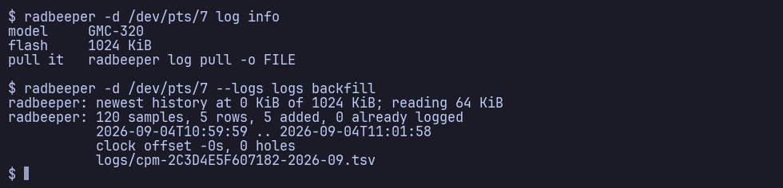

*`log info`, then `backfill`. The simulated counter's flash holds two minutes
from 2026-09-04, built by the test fixture in the shape a real GMC-320 writes.*

1. `log info`: the model and the size of its flash (1024 KiB), and the
   command that downloads all of it.
2. `backfill`: where the newest history is, how much it read, and what it did:
   120 samples, 5 rows added, none already logged.
3. The stretch it covered, the counter's clock offset, the holes, and the file
   it wrote, `cpm-2C3D4E5F607182-2026-09.tsv`. Running it again adds nothing:
   rows already logged are left alone.

**Check yourself**

- `backfill`, `log pull` and `clock --set` need the port itself, so stop the
  service first: `doas rc-service radbeeper stop`.
- A counter that lost its battery comes back reading the year 2000; the next
  start of `service` or `watch` corrects it.

<a id="part-7"></a>
## 7. Random numbers out of decay

**Why it exists.** The moment an atom decays is not decided by anything, so a
counter is a source of true randomness. RadBeeper makes a 256-bit key when it
has *measured* enough min-entropy in the counts to justify one, not when a
model says it should have.

**How it fits.** The monitor and the service draw keys continuously and log
them beside the counts (`random-<serial>-YYYY-MM.tsv`); `radbeeper random`
draws one on demand. Each key is kept with the counts behind it, so anybody can
recompute it (`random --check`), and the published audit page (part 9) shows
the work.

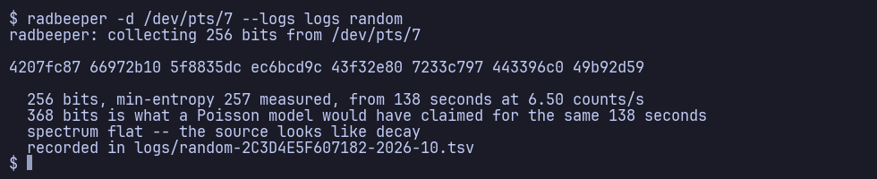

*`radbeeper random` on the third simulated counter, at 400 CPM so that it
finishes in about two minutes.*

1. The key: 256 bits, as eight groups of hex.
2. How it was earned: min-entropy *measured* at 257 bits from 138 seconds of
   counts at 6.50 a second.
3. What a Poisson model would have claimed for the same seconds (368 bits):
   the model would have handed the key over early and overstated it.
4. The health check on the same counts (`spectrum flat -- the source looks
   like decay`), and the file the line was recorded in.

> Treat this as a good physical source, not a certified one. It has not been
> through a statistical test battery. — [The random](the-random.md)

**Check yourself**

- The bits come from SHA-256 over the counts, not from the spectrum and not
  from shifting and XOR-ing: [the random](the-random.md) explains why each of
  those would overstate what is there.
- "spectrum flat" is a health check, not a proof: a key whose counts fail it
  is marked suspect.

<a id="part-8"></a>
## 8. The raw seconds behind every key: frames

**Why it exists.** A key is only checkable if the seconds that made it are
kept. Since 0.5 every emission also writes a **frame**, the raw seconds behind
that one key, in an append-only binary file that costs one byte for an
ordinary second. Every emission is also chained to the one before it by
`H(prev ‖ key)`, so a key removed or altered later shows, and `frames verify`
checks every key and every link from the first.

**How it fits.** Only the process holding the serial port writes frames (the
service or the monitor). `frames list`, `show`, `verify`, `export` and
`import` read them; `export --frames-page` turns them into `frames.html`, a
browser of months, days and frames.

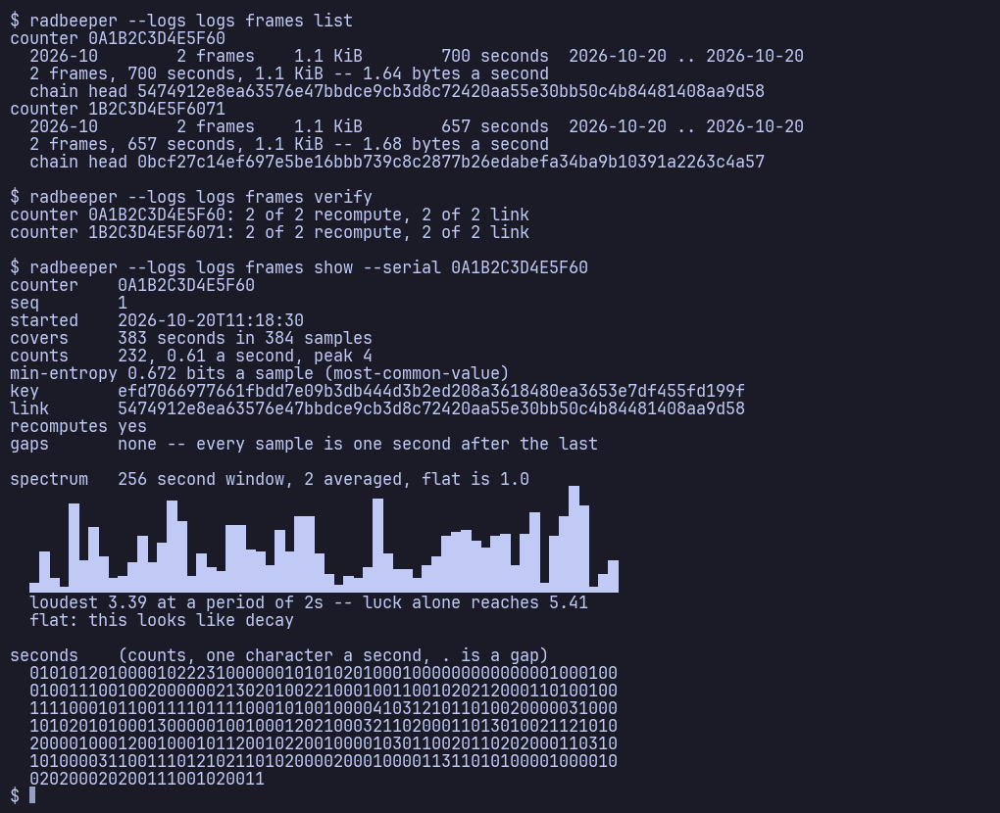

*The frames the monitor in part 2 wrote while it ran.*

1. `frames list`: per counter and month, how many frames, how many seconds
   and bytes, and the head of the chain.
2. `frames verify`: every key recomputed from its own seconds, and every link
   of the chain checked: `2 of 2 recompute, 2 of 2 link`.
3. `frames show`: one frame. When it started, how many seconds it covers, the
   counts, the min-entropy per sample, the key (the same `efd70669…` the
   monitor showed in part 2) and its link.
4. The frame's spectrum, with its verdict: the loudest peak (3.39) against
   what luck alone reaches (5.41), so `flat: this looks like decay`.
5. The raw seconds themselves, one character a second, with `.` for a gap.

**Check yourself**

- No frames at all? The process holding the port is writing them only if it
  is a build from 0.5 on and was not started with `--no-frames`.
- [Reading the raw record](the-frame-browser.md) and [the monthly
  record](the-monthly-record.md) are the lab reports.

<a id="part-9"></a>
## 9. Publish it: one page, no scripts

**Why it exists.** A measurement nobody else can check is an anecdote. The
export turns the logs into one self-contained page, with no JavaScript, no web
fonts and no CDN, that can be put anywhere a file can.

**How it fits.** It reads only the log files of part 5. `random.html` is
written beside it whenever there are keys to account for. To publish, fork the
repository, copy your logs into `logs/` and push: `.github/workflows/pages.yml`
rebuilds the pages and GitHub Pages serves them.

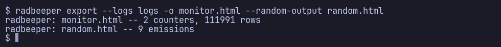

*`radbeeper export --logs logs -o monitor.html`, run on this repository's own
`logs/`.*

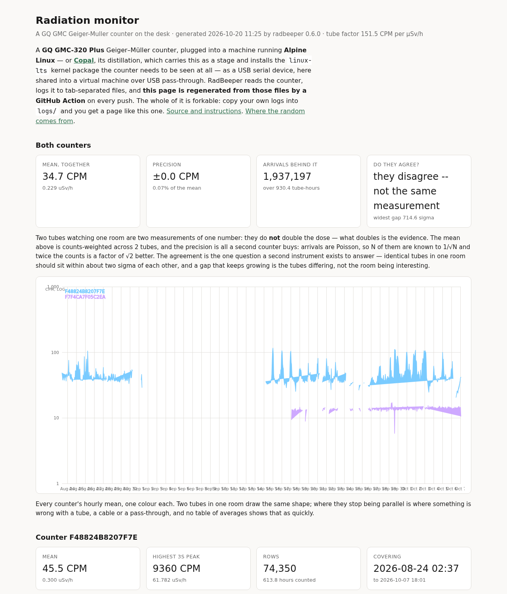

*The top of `monitor.html`, built from the repository's published logs.*

1. What the page is, when and by which version it was generated, and the
   tube factor used.
2. **Both counters**: the mean together, its precision, the arrivals behind
   it, and **do they agree?** Here the answer is *they disagree -- not the
   same measurement*: the page says so plainly rather than averaging it away.
3. Every counter's hourly mean on a log scale, one colour each; where two
   tubes in one room stop running parallel is where something is wrong with a
   tube, a cable or a pass-through.
4. Then a section per counter (its mean, highest peak, rows and coverage), and,
   below this picture, the table by day and the newest rows.

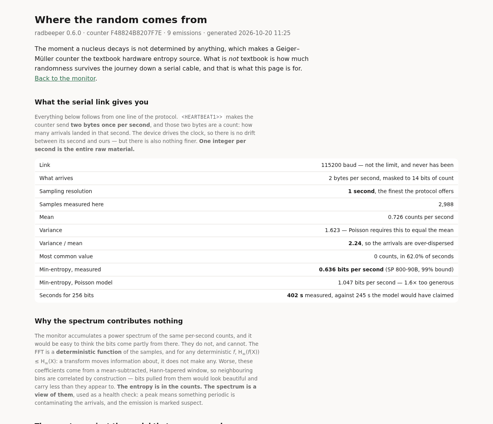

*The top of `random.html`, the audit page for the keys in the same logs.*

1. What the serial link gives: two bytes once a second, so one integer per
   second is the whole of the raw material.
2. What was measured here: the mean and variance of the counts, the most
   common value, and the min-entropy measured (SP 800-90B, 99% bound) against
   what the Poisson model would claim.
3. Why the spectrum contributes nothing to the bits, and is used only as a
   health check. Further down: every emission with the counts behind it.

**Check yourself**

- `watch` writes both pages into the log directory by itself, after its
  backfill, every hour and on quit.
- A place is recorded per serial number over time with `radbeeper site`, and a
  coordinate only at the precision chosen when it is written (three decimal
  places by default, about 110 m). The rounding happens on the way in.

<a id="part-10"></a>
## 10. How it fits together

One counter, one process holding its port, and everything else reading what
that process serves or writes.

| Part | Command | What it reads | What it writes | Why it exists |
| --- | --- | --- | --- | --- |
| Find | `probe` | the port, or the service's socket | nothing | so the first answer is "it works" or which of four things is wrong |
| Watch | `watch` | the port, or the socket | the log, keys, frames, `index.html` | five time constants at once, and no hole in the log while watching |
| Log at boot | `service` | every counter found | the log, keys, frames; serves the socket | a record whether or not anybody is looking |
| Open on plug-in | `hotplug` | `/dev` | nothing | the monitor appears when a counter does |
| Window | `radbeeper-gui` | the socket only | nothing | an instrument cluster to leave open on a desk |
| Is it radiation? | the spectrum, the drum | the counts | nothing | a rhythm is not decay |
| Fill the gaps | `backfill`, `log pull` | the counter's flash | rows marked `flash` | the counter kept counting while nothing listened |
| Clock | `clock [--set]` | the counter's clock | the counter's clock | flash rows are placed by it |
| Keys | `random` | the counts | `random-*.tsv`, `.hex` | true randomness, with the evidence kept |
| Frames | `frames …` | `random-*.bin` | `frames.html` (via `export`) | every key can be recomputed from its seconds |
| Place | `site` | `sites.tsv` | `sites.tsv` | a reading without a place is half a measurement |
| Publish | `export`, `pages` | the logs, the documents | `monitor.html`, `random.html`, the site | a measurement others can check |

Two implementations share one file format: the native Rust build is what
`cargo install` gives you, and the one-file Python `radbeeper` at the root of
the repository is the reference that owns the log format and the verbs not yet
ported (`site`, `recompute`, `--source sim`, `--plain`).
`tests/test_differential.py` checks that both write the same bytes.

To take these pictures again: `python3 tools/featureguide.py` (about fifteen
minutes; needs Pillow, as `make promo` does, and Chromium for the two pages).
The monitor's recording is several megabytes; on a machine with a small
`/tmp`, give it somewhere else with `--work DIR`.
