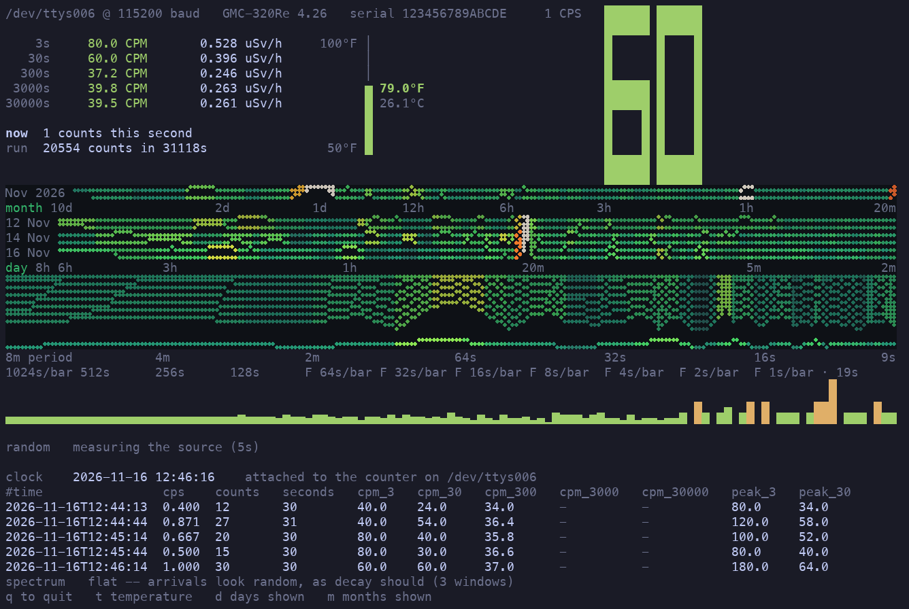
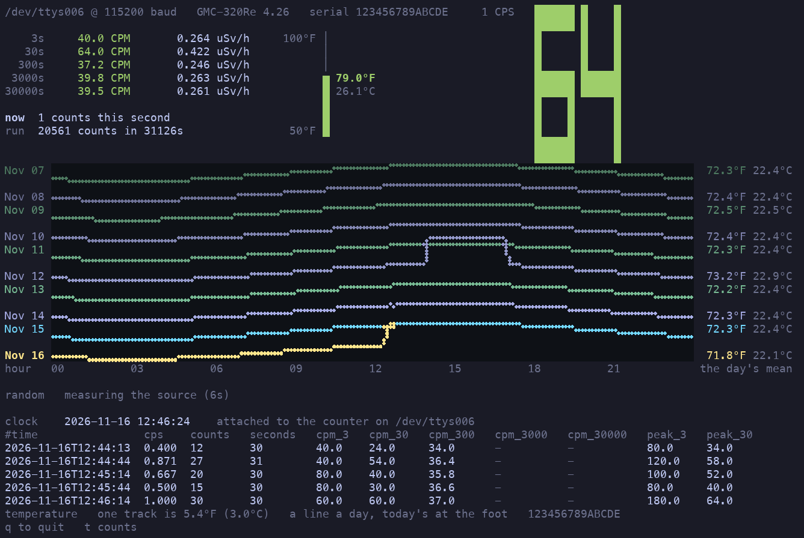
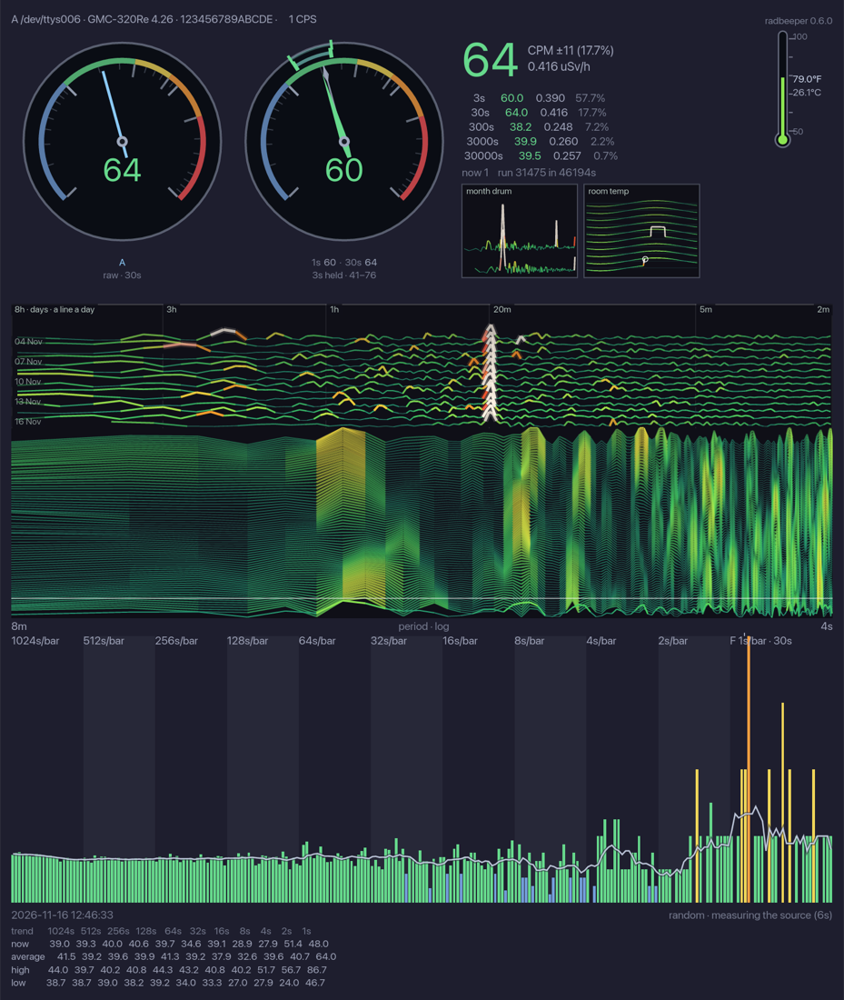
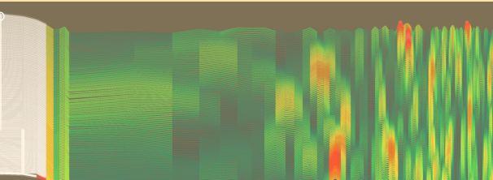
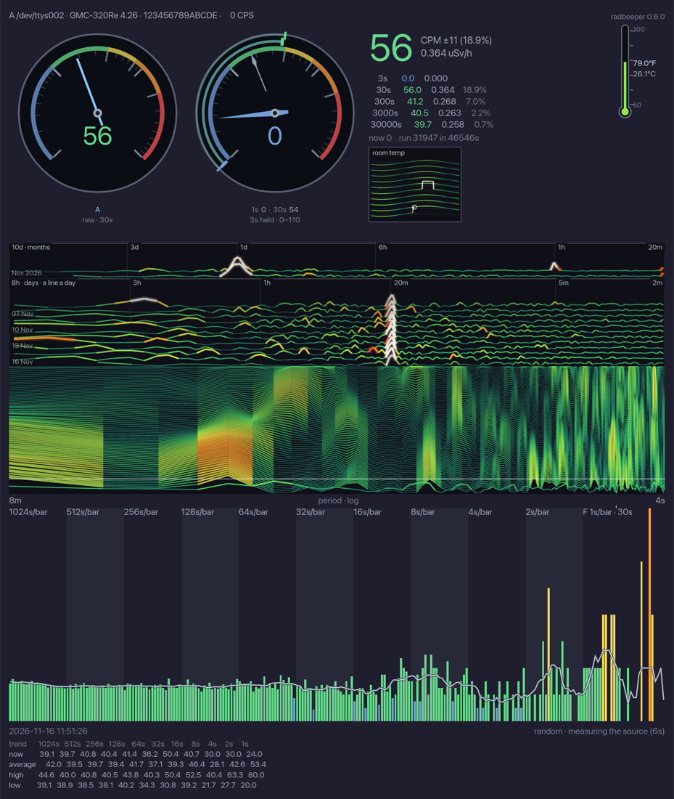
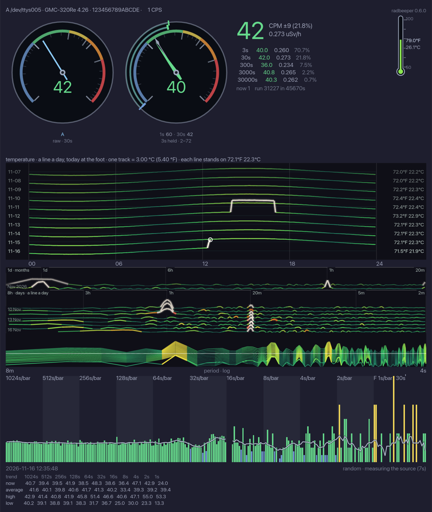
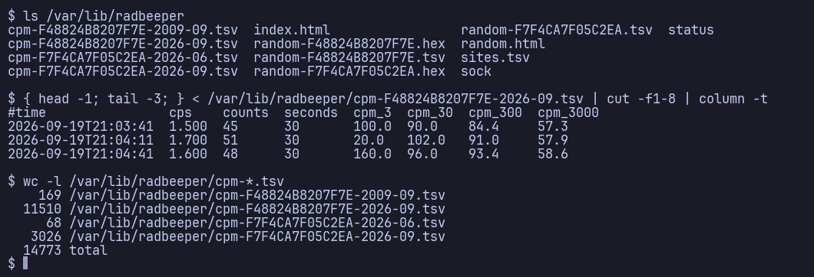

<!-- SPDX-License-Identifier: MIT — Copyright (c) 2026 Paul Richeson -->

# A tour of RadBeeper

**What each part looks like and what it is for: the monitor in a terminal,
the window, the drum spectrogram and its day and month papers, the
temperature, two counters, the record, the web page and the random numbers.**

*This was the middle of the README until 16 November 2026, when the README
was cut down to what the program is and how to install it.*

---

## The monitor

```sh
radbeeper watch
```



Everything on one screen of a terminal: the reading in large digits, the five
averages, a small thermometer, the drum spectrogram with a line for each day
and each month above it, the strip of counts, and the rows as they are
written to the log.

| Key | |
|---|---|
| `d` | the day paper: shown, folded to one row, off |
| `m` | the month paper, the same |
| `t` | the temperature, ten days of it, a line a day |
| `q` | quit |



---

## The window

```sh
radbeeper-gui
```



| From the top | What it tells you |
|---|---|
| **The counters** | Which counters are connected, and what each counted in the last second. An empty space means that counter has stopped answering. |
| **The dials** | The reading as a needle. The coloured bands are *nominal*, *advisory*, *warning* and *deadly*. |
| **The thermometer** | The counter's own temperature, top right, in °F and °C. Click it for ten days of it. |
| **The tiles** | A chart you have folded away, small, under the big number. Click one to open it. |
| **The big number** | Counts per minute over the last half minute, how precise that is, and the dose rate. |
| **The averages** | The same reading over 3 seconds, 30 seconds, 5 minutes, 50 minutes and a working day. |
| **The striped chart** | The check for rhythms. Mostly green is the good answer. The lines at its top are whole days, and above them whole months. See [Reading the drum spectrogram](reading-the-drum-spectrogram.md). |
| **The counts** | A bar for each second on the right, with older counts packed closer together to the left. The line over the bars is the trend. **Point at a bar** to see when it was and what it read. |
| **The key** | The newest random number, and which counter it came from. |
| **The table** | The trend line in numbers: for each panel of the counts, where the trend is now, its average over that panel, and its high and low, in CPM. |

The moving picture at the top is a real room: two counters on 16 November
2026, half a minute as it happened. The still pictures of the window and the
monitor below it were taken the same day over made-up logs with rhythms put
in on purpose, so there is something to see; a real room is mostly green.

The window follows your desktop's light or dark theme, and fits whatever
space it is given: in a small window the table goes first and the charts
last.

---

## The drum spectrogram



Decay has no rhythm. Anything that reaches the counter on a schedule is
something else: a fan, electrical noise, a fault. In the reading it looks
like more radiation. On this chart it looks like a stripe.

It is drawn like a seismograph's paper. A new line appears at the bottom
every eight seconds, just above the counts, and the older ones move up. Left to right is how often
something repeats, from once an hour to once every few seconds. The pen gets
hotter and wider as the signal gets stronger: **green is ordinary
background, yellow is as much as chance manages, red and white are more.**

- **Mostly green** — all is well.
- **A warm patch that comes and goes** — chance.
- **A hot stripe from top to bottom that stays put** — something real is
  arriving at that interval.

### Days and months



Twelve minutes of paper cannot show what happens once an hour. Above the live
drum are two more: **a line for each day and a line for each month**, made
from the log the counter was already keeping, so they are full when the
window opens. A stripe running up through the days is something that arrived
on that schedule day after day. Click a paper, or press `d` or `m`, to fold
it into a small tile beside the dials.

### The temperature



The small thermometer at the top right is the counter's own, in °F and °C.
Click it, or press `t`, for the last ten days: a line a day, today's at the
foot and yesterday's one track above.

**[Reading the drum spectrogram](reading-the-drum-spectrogram.md)** is
the guide, with pictures. **[The drum
spectrogram](the-drum-spectrogram.md)** is the lab report on the
technique.

---

## Two counters

Plug in a second counter and both are read. There is nothing to set and
nothing to restart.

Two counters in one room do not double the reading. They make it more
precise, and the window shows by how much. Each keeps its own log. If one
stops answering it is left out until it comes back, and the reading stays
right.

---

## Keep a record

```sh
radbeeper service         # what runs at boot, here in the foreground
```



A row every thirty seconds, in a plain text file for each counter and each
month. It opens in any spreadsheet. The monitor writes the same rows while it
is open, so it does not matter which of them is running.

---

## Publish it

```sh
radbeeper export --logs logs -o monitor.html
```

One page with a summary, a chart by the hour, a table by the day and the
newest rows. It is a single file with no scripts.

To put it on the web, fork this repository, copy your log files into
`logs/`, and push. The site rebuilds itself.

---

## Random numbers

```sh
radbeeper random
```

```
b17c9c60 d5deeb7b 4b102dfc bec14efc b523818b 18d3ada0 582bd912 e61ff856
```

The moment an atom decays is not decided by anything, so a counter is a
source of true randomness. RadBeeper makes a 256-bit key when it has counted
enough to justify one, and keeps the counts behind it so anybody can check
it.

> Treat this as a good physical source, not a certified one.

---

[← back to the overview](../README.md)
